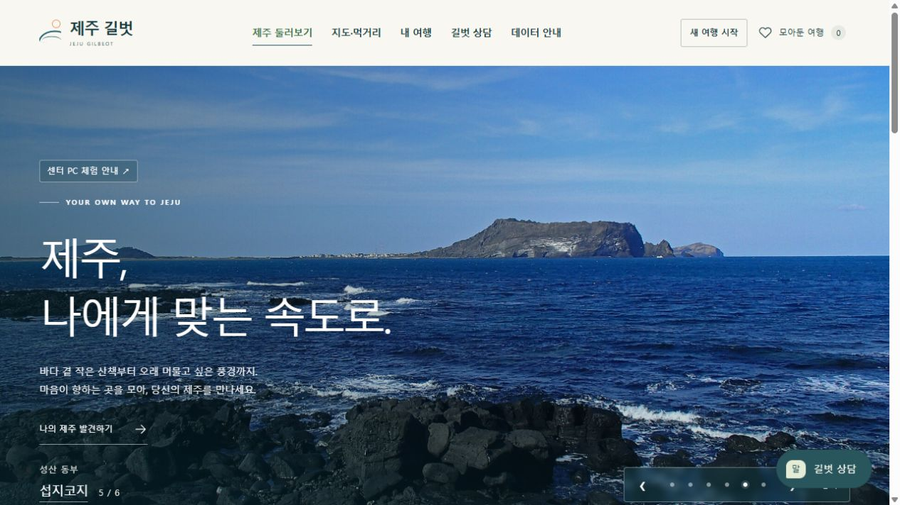

# 제주 길벗 v27

제주 길벗은 제주 관광지의 출처를 찾아보고, 먹거리 이용 경향을 비교하며, 출발·복귀 조건에 맞는 하루 일정을 만드는 로컬 웹앱입니다. 제주빅데이터센터가 제공하고 제주데이터허브가 공개한 카드 집계 자료를 분석합니다. 관광 명부와 공식 안내, OpenStreetMap을 연결해 장소와 이동 경로를 확인합니다.



섭지코지 사진 [Lcarrion88, CC BY-SA 4.0](https://commons.wikimedia.org/wiki/File:Seopjikoji.jpg).

[서비스 기획서 PDF](docs/제안서_v27/제주길벗_서비스기획서_v27.pdf) · [편집용 Word](docs/제안서_v27/제주길벗_서비스기획서_v27.docx) · [v27 점검과 재검증](docs/서비스_경계및부하점검_v27_20261106.md) · [사진·이미지 출처](docs/PHOTO_CREDITS.md)

## 처음 실행하기

1. **GitHub에서 복원합니다.** Git과 Python이 설치된 Windows PC에서 저장소를 복제하고 `python -B dev.py restore`를 실행합니다. 최초 복원은 공식 원자료 다운로드에 인터넷을 사용합니다. [복원 명령과 출처](GITHUB_RESTORE.md)
2. **`run_center.cmd`를 실행합니다.** 전체 로컬 패키지가 있는 PC에서도 같은 명령을 사용합니다. 브라우저가 자동으로 열리지 않으면 서버를 실행한 PC에서 [제주 길벗 홈](http://127.0.0.1:8765/)을 여세요.
3. **홈에서 ‘센터 PC 체험 안내’를 엽니다.** ‘로컬 실행과 인터넷 연결 범위’ 안에서 ‘실행 상태 확인’을 누르면 운영 모델, 관광 후보, 유효한 공식 소개와 도로 파일 상태를 확인할 수 있습니다. 정상 응답의 예는 운영 모델 3종, 자동 코스 후보 40곳, 유효한 공식 소개 62곳입니다. 소개 건수는 출처의 재검토 상태에 따라 달라질 수 있습니다.

사용하는 동안 실행 창을 열어 둡니다. 종료할 때 실행 창에서 `Ctrl+C`를 누르거나 창을 닫으세요. 로컬 서버는 `127.0.0.1`에 연결되므로 실행한 PC에서 사용합니다. 외부 원문 링크와 선택형 온라인 지도는 연결이 필요합니다.

## 5분 체험

| 체험 | 따라 하기 | 확인할 결과 |
| --- | --- | --- |
| 공식 관광지 소개 | [내 여행 → 공식 관광지 소개 찾기](http://127.0.0.1:8765/planner#official-guide)에서 `성산일출봉`이나 `제주 전통 가옥`을 검색합니다. | 소개 출처와 확인일, 일정에 넣기 전에 검토할 사유를 볼 수 있습니다. |
| 외식업종 비교 | [지도·먹거리 → 자료 비교](http://127.0.0.1:8765/explore#data-guide)에서 ‘세부 외식업종’을 선택합니다. 참고할 월을 고르고 `커피`를 입력해 비교합니다. | 업종별 추정 이용 비중과 과거 평가 오차를 함께 봅니다. |
| 하루 코스 | [내 여행 → 일정 조건 입력](http://127.0.0.1:8765/planner#planner-form)에서 ‘예시 조건 채우기’, ‘제주공항 출발로 확인’, ‘조건에 맞는 코스 추천’을 차례로 누릅니다. | 자동차로 북부 최대 3곳을 찾습니다. 예시는 09:00~18:00, 이동비 한도 100,000원, 공항 복귀입니다. 결과에서 장소 순서, 복귀 시각, 도로 참고 경로와 출처를 확인합니다. |

**장소를 직접 담아 방문하기.** 관광지나 위치 자료가 있는 음식점의 상세 카드에서 장소를 담고, 내 여행의 ‘담은 장소의 순서 만들기’를 선택합니다. 탭에 담은 장소는 최대 24곳입니다. ‘담아둔 장소 모두’를 선택하면 시간·이동비·방문 조건을 검사합니다. 출처나 방문 조건의 확인이 필요한 장소는 사유를 표시합니다. 장소 상세 조회에 일시적으로 실패하면 목록에 확인 대기로 남고, 다시 확인하거나 직접 뺄 수 있습니다.

**여행 중 코스 바꾸기.** 자동 일정에서 ‘여행 중 일정 다시 짜기’를 열고 일정에 포함된 공개 관광지를 현재 출발지로 확인하고 이미 방문한 곳, 새 출발 시각과 남은 이동비를 고릅니다. 기존 도착지와 마감을 유지한 채 다시 계산하거나 ‘기존 도착지로 바로 가기’를 선택할 수 있습니다. 일정은 HTML로 내려받을 수 있습니다. [일정 조정과 도로 검증](docs/개선및검증_v27.md)

**길벗 상담.** ‘길벗 상담’에서 `동부 갈치 추천`처럼 검색합니다. 주변 검색을 선택할 때만 위치를 사용하고, 직접 고른 기준 장소로도 검색할 수 있습니다. 적용할 수 없는 제외·실시간 조건은 안내하고, 방문 검토가 필요한 카드는 사유와 출처를 보여줍니다. [상담 재검증](docs/서비스_경계및부하점검_v27_20261106.md#수정-후-재검증)

**실제 CSV 비교.** [센터 PC 체험 안내](http://127.0.0.1:8765/about#center-experience)의 ‘공개 1048 CSV로 두 시점 비교’에서 제주데이터허브 1048 형식의 파일을 선택합니다. 8MiB 이하 UTF-8 또는 한글 CSV의 `base_year_month`, `biz_nm`, `user_type`, `sex`, `use_count` 열을 읽습니다. 같은 집단의 두 관측 월과 월별 모델 참고값을 비교할 수 있습니다. 파일과 관측값은 브라우저 탭에서 집계하며, 참고값을 요청할 때는 월과 집단만 로컬 서버에 보냅니다. [1048 공개 원자료](https://www.jejudatahub.net/data/view/data/1048)

## AI 기능과 데이터

| 운영 기능 | 자료와 처리 | 평가 범위 |
| --- | --- | --- |
| 도민·내국인 8개 식음료 업종 구성비 | [제주데이터허브 1048](https://www.jejudatahub.net/data/view/data/1048) 카드 이용건수에서 월별 비중을 만들고 계절·추세 릿지 회귀로 관심 달의 구성비를 추정합니다. | 2024.01~2025.06 고정 시험에서 ±1%p 안에 들어온 270/288셀(93.75%), 평균 절대오차 0.328%p. |
| 세부 외식업종 구성비 | [제주데이터허브 1047](https://www.jejudatahub.net/data/view/data/1047) 카드 이용건수로 완전 관측 외식업종의 월별 구성비를 추정합니다. | 2023.01~2024.12의 실제 21개월 고정 시험에서 ±0.25%p 안에 들어온 1,790/1,974셀(90.68%), 평균 절대오차 0.097%p. |
| 공식 관광지 소개 검색 | [제주데이터허브 1349](https://www.jejudatahub.net/data/view/data/1349) 명부, OSM 교차확인, 비짓제주·한국관광공사 공식 소개 기록을 사용합니다. 확인한 이름이 일치하면 우선 표시하고, 주제 검색은 문서의 단어·문자 TF-IDF로 순위를 계산합니다. | 동결한 작성 질의 22건 중 22건 통과. 정답의 첫 결과 또는 지원 범위 밖 질문의 빈 응답을 검사한 수치입니다. |

±1%p 이내는 실제 비중이 20%라면 추정값이 19~21%에 들어온 경우입니다. 각 결과는 평가기간과 표본 안에서 해석합니다. [운영 모델과 평가 기준](docs/운영모델_v23.md)

일정은 출발지를 확인한 뒤 명부 검색, 출처·방문 정책, 시간·예산 제한, 도로 재검사를 차례로 적용합니다. 상담은 규칙과 준비한 안내문을 사용합니다. 운영 모델은 Python에서 로컬로 실행됩니다. 외부 LLM 호출이나 키 등록 없이 기본 기능을 쓸 수 있습니다. 음식점은 [제주데이터허브 780](https://www.jejudatahub.net/data/view/data/780) 인허가 명부와 OSM 위치를 참고하며, 음식점 선택은 사용자가 직접 합니다. 올레길·무장애 여행지·해수욕장 시설, 숲길과 마을편의시설 자료는 탐색과 자료 비교에 씁니다. [사용 자료 전체 목록](docs/도로가속_v25.md#서비스가-쓰는-구조화-원본-12종) · [원본과 수집 명세](config/download_manifest.json)

## 이용 범위와 개인정보

- 장소의 영업·휴무·예약·입장료·실제 입구는 방문 전 운영기관에서 확인합니다. 자동차 이동시간과 비용은 로컬 도로 거리와 가정 속도를 적용한 추정값입니다. 도로 연결을 확인할 수 없으면 보정한 직선거리를 사용합니다. 입장·식사·주차비는 이동비와 별도입니다.
- 출발지는 공항, 직접 고른 기준 장소 또는 입력한 좌표를 사용자가 확인합니다. 기기 위치는 사용자가 동의하면 주변 검색에 활용하고, 원할 때 일정 출발지로 따로 확인할 수 있습니다. 파일 선택과 여행 기록은 해당 브라우저 탭에서 관리되며, HTML 일정에는 정밀 출발지 좌표를 넣지 않습니다.
- 분석 화면에서 보는 구성비는 과거 관측과 달력 월을 기준으로 합니다. 버스 시간표는 해당 운행기관에서 확인하세요.

## 다른 PC에서 복원하기

비공개 GitHub 저장소를 복제한 뒤 Python으로 운영 자료를 복원할 수 있습니다. 공식 파일을 내려받고 서비스 검증을 마치는 순서는 [다른 Windows PC 복원 안내](GITHUB_RESTORE.md)에 있습니다.

| 폴더 | 내용 |
| --- | --- |
| `ui/` | 브라우저 화면, 지도, 사진 및 공개 라이선스 표시 |
| `jeju_agent/` | 로컬 서버, 조회, 일정 조정, 모델 추론 |
| `config/` | 원본 명세, 출처와 방문 검토 정책 |
| `data_raw/`, `data_reference/` | 원본과 검증 자료, 로컬 조회·도로 데이터 |
| `models_candidates_v23/`, `models_dining/` | 1048과 1047 운영 모델 및 검증 자료 |
| `runtime/`, `scripts/`, `tests/`, `docs/` | 동봉 Python, 가공·평가 도구, 검사, 기획서와 기술 기록 |

## 실행이 안 될 때

| 증상 | 확인할 내용 |
| --- | --- |
| Python 실행 파일을 찾을 수 없음 | Python 3.10 이상을 설치하고 PowerShell에서 `python --version`을 확인합니다. |
| 브라우저가 열리지 않음 | 실행 창의 주소를 같은 PC의 브라우저에서 직접 엽니다. 기본 주소는 `http://127.0.0.1:8765/`입니다. |
| 8765 포트가 이미 사용 중 | 이전 실행 창을 닫거나 PowerShell에서 `.\run_center.cmd --port 8766`을 실행하고 `http://127.0.0.1:8766/`을 엽니다. |
| 모델 또는 로컬 도로 파일 확인 필요 | ‘센터 PC 체험 안내’에서 실행 상태를 확인한 뒤, 아래 서비스 검사를 실행합니다. GitHub 복제본은 복원 안내의 명령으로 실행 자료를 준비합니다. |
| 일정이 만들어지지 않음 | 출발지 확인 여부, 마치는 시각, 이동비 한도와 장소별 방문 검토 사유를 살펴봅니다. |

## 개발과 검증

프로젝트 루트에서 PowerShell을 열고 실행합니다. GitHub 복제본은 설치된 Python을 사용합니다.

```powershell
python -B dev.py check --service
python -B dev.py test
python -B dev.py run --port 8765
```

`check`는 전체 v27 이전본 파일과 해시를 확인합니다. `check --service`는 현재 서비스 자료와 운영 상태를 확인합니다. `test`는 Python 검사와 Node 기반 UI·JavaScript 검사를 실행합니다. 이전 실험까지 포함한 전체 테스트에는 전체 로컬 작업본의 실험 자료가 필요합니다. Node 경로를 직접 지정하려면 `.\runtime\python.exe -B dev.py test --node 'C:\path\to\node.exe'`를 사용하세요. `test --python-only`는 Python 검사만 실행합니다. `dev.py run`은 브라우저를 열지 않고 서버를 시작합니다. 배치 파일에서도 `.\run_center.cmd --no-browser`를 사용할 수 있습니다. 기본 실행은 CPU이며, 지원되는 OpenCL 장치에서 자동차 도로 연결 노드 가속을 실험하려면 `.\run_center.cmd --road-gpu`를 사용합니다. [도로 가속 범위](docs/도로가속_v25.md)

수정 후 개발 PC에서 Python 344개, UI 테스트 파일 22개, JavaScript 문법 검사 14개, 검색·상담 HTTP 101건을 통과했습니다. 브라우저에서도 방문 제한, 기준점 반경 1km 검색, 일정 마감과 이동비 경계를 확인했습니다. [점검 환경과 재현 명령](docs/서비스_경계및부하점검_v27_20261106.md)

[센터 설치와 제출 검토 기록](docs/센터검증_v24/센터운영과_제출점검.md) · [v24 기획서 원고](docs/제안서_v24/제주길벗_서비스제안서_v24.md) · [v21 승차 예측 실험](docs/모델다양화_v21/승차_추가정보_실험.md)
