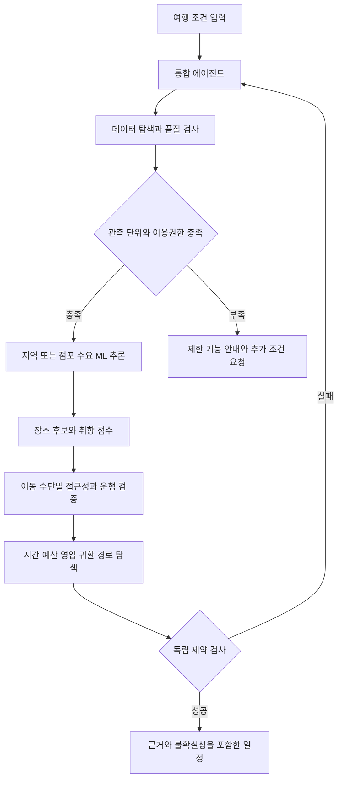

# 통합 에이전트와 시스템 상세 설계

추천의 수치 근거는 머신러닝 모델이 만들고, 통합 에이전트는 데이터와 실행 도구를 선택하고 결과를 검증한다. 자연어 설명 모델은 선택 기능이다. LLM이 방문량·버스 시간·가격을 만들어내거나 데이터 미확보를 숨기지 않도록 근거 구조를 강제한다.

## 서비스 흐름

이 그림은 운영형 목표다. 현재 시제품은 요청검사→데이터검사→ML예측→후보점수→경로검색→설명의 6개 단계가 한 프로세스 안에서 실행된다. 재계획 루프·실시간 탐색·독립 LLM 협업은 아직 구현하지 않았다.

## 전문 에이전트 계약

| 역할 | 입력 | 도구와 출력 | 자율 판단 범위 |
|---|---|---|---|
| 통합 계획 | 요청, 데이터 상태, 실패 원인 | 구조화 TaskPlan, 실행 순서 | 허용된 도구 선택, 최대 2회 재계획 |
| 데이터 탐색 | 카탈로그, 출처 허용목록 | 명세 검색, 데이터 계약, freshness 보고 | 필요한 자료 선택, 승인 없는 다운로드 제외 |
| 품질 검증 | 원본·스키마·코드북 | 중복·좌표·기간·단위·권한 검사 | 오류 자료 제외, 불명확 값 격리 |
| 수요 예측 | 모델과 시점별 특징 | ML forecast, 단위, 모델 버전 | 입력 적합성 판단과 기준모델 전환 |
| 음식점 후보 | 영업 중 장소, 취향, 지역 맥락 | 후보와 항목별 점수 | 필터링·다양성·유사 후보 선택 |
| 교통 검증 | 출발 시각, 교통 그래프 | 구간 시간·요금·환승·근거 | 운행 가능 후보만 허용 |
| 일정 최적화 | 후보 효용, 구간 행렬, 제약 | 순서·도착·체류·귀환 | 방문 수와 순서 조정 |
| 독립 검증과 설명 | 최종 일정, 출처, 모델 메타 | 제약 검증, evidence, 설명 | 실패 반환, 근거 없는 표현 제거 |

현재 단계명을 에이전트로 부르지만 구현은 결정적 도구 모듈이다. 운영형에서는 통합 계획 에이전트만 도구 선택과 재계획을 수행하고 전문 ML·경로 도구는 재현 가능한 함수로 유지하는 편이 센터 PC에서 유리하다.

## 공통 상태

`TravelRequest`에는 날짜, 시작/종료 위치와 시각, 교통수단, 총예산, 인원, 선호 태그, 혼잡 회피, 필수 장소, 최대 방문 수를 둔다. 현재 코드는 인원·필수 장소를 받지 않으며 1인 하루 기준이다. 운영형에서 인원별 식비와 차량 공통비를 구분한다.

`Evidence`에는 dataset_id, original_dataset_id, provider, 관측 기간, available_at, 관측 단위, measure, source_url, model_version, confidence_reason을 둔다. 장소 주소의 출처와 지역 수요의 출처를 별도로 남긴다. 예측값과 관측값은 필드 이름부터 분리한다.

`AgentResult`는 status, payload, evidence, warnings, duration, retryable, error_code를 공통으로 쓴다. 전체 계획은 하나의 request_id로 묶고 단계별 입력·모델 버전·오류를 JSONL로 기록한다. API Key와 개인 위치 원문을 로그에 남기지 않는다.

## 예외와 복구

- 데이터 없음: 출처 상태와 사용 불가 기능을 알린다. 합성 자료로 조용히 바꾸지 않는다.
- 새 지역 또는 적은 관측: 상위 지역 기준모델을 쓰고 근거 부족을 표시한다. 인기 식당 배지는 붙이지 않는다.
- 예산·시간 불가능: 방문 수를 줄여 재검색한다. 사용자가 지정한 필수 장소나 예산을 임의로 변경하지 않는다.
- 버스 자료 부족: 버스 길찾기를 중단한다. 사용자가 자동차·도보를 선택하면 해당 조건으로 다시 계산한다.
- 외부 API 실패: 마지막 승인 캐시의 기준시각과 유효범위를 표시한다. 시한이 지난 막차 정보는 재사용하지 않는다.
- 재계획 한도 초과: 실패 원인과 조절 가능한 조건을 반환한다. 무한 반복을 막는다.

## 모델과 LLM 경계

현재 모델은 표준 라이브러리 Ridge 회귀다. 수요값은 학습한 계수에서 나온다. 취향 태그와 점수 가중치는 명시적 규칙이며 학습된 개인화라고 부르지 않는다. 경로 최적화 역시 ML 예측을 사용하는 탐색 알고리즘이다.

선택적 LLM은 자연어 조건을 스키마로 변환하고 evidence만 읽어 설명한다. 사용할 모델명·버전·비용·외부 전송 항목은 도입 시 확정한다. 센터 PC 사양만으로 대형 모델 상주를 전제하지 않는다. 인터넷·키 없이도 폼 입력과 템플릿 설명으로 핵심 기능이 작동해야 한다.

`prompts/orchestrator.md`와 `prompts/explainer.md`는 향후 연결용 명세다. 현재 실행 중 LLM이 호출되는 프롬프트가 아니다.

## UI와 운영

입력 화면은 폼으로 시작하며 결과에는 추천 순서·도착 및 체류시각·예산·복귀시각·데이터 관측일·예측 근거를 보여준다. 인기 경로 관측 여부와 지역 맥락 추천 여부를 구분한다. 분석 탭은 비전문가가 이용 가능한 데이터, 예측 단위, 기준모델 대비 결과를 살펴보고 CSV 보고서를 내려받는 기능으로 확장한다.

로컬 MVP는 HTTP 127.0.0.1에만 바인딩하고 외부 지도·폰트·CDN을 쓰지 않는다. 현재 지도는 좌표 개략도다. 운영형 도로 지도는 허가된 타일과 도로망 라이선스를 따로 명시한다.
