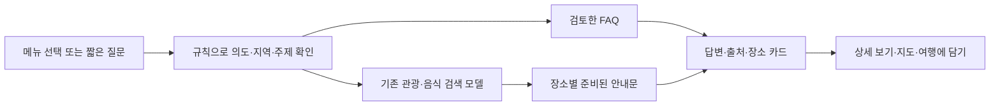

# LLM 없이 동작하는 길벗 상담

## 구성

화면 오른쪽 아래 **길벗 상담**을 누르면 버튼 선택과 짧은 질문으로 안내한다. 외부 챗봇 API, LLM, GPU가 필요 없다. 기존 여행 화면과 같은 PC에서 실행한다.

FAQ는 서비스 사용법·데이터 범위·위치·지도·일정·미확인 정보 안내를 담는다. 장소별 안내문은 확보한 원자료의 실제 필드를 일정한 문장 틀에 채워 미리 저장한다. 답변 기록 수는 출처별 수이며 서로 다른 출처가 같은 실제 장소를 가리킬 수 있다. 수만 개를 사람이 개별 집필했거나 모두 현재 운영까지 검증했다는 의미가 아니다.

현재 장소별 안내는 33,585개(관광·자연 1,148, 허브 명부 참조 5,381, 음식 27,056)이며 직접 작성한 서비스 FAQ는 26개다. 같은 이름과 가까운 좌표가 확인되는 출처 기록은 추천 화면에서 하나로 묶되 원본 안내문과 출처별 기록 수는 보존한다.

## 대화 예시

- `관광지 추천` → 지역·테마 선택
- `북부 해변 추천해줘` → 기존 관광 검색 모델로 후보 안내
- `두 번째 장소 알려줘` → 직전 후보의 장소별 안내문
- `주소 알려줘`, `영업시간은?` → 선택 장소의 원자료를 확인한 답변
- `고기국수 먹고 싶어` → 기존 음식 검색 모델의 관련 업소 기록
- `다른 곳`, `서부로` → 직전 검색 주제에서 후보 변경
- `경로는 어떻게 만드나요?` → 담기·경로 생성 기능 안내
- `데이터는 어디서 가져왔어?` → 허브·센터·비짓제주·OSM 자료 범위 안내

짧은 규칙 기반 상담이므로 복잡한 복합 문장이나 모든 표현을 이해하지는 않는다. 검색 후보가 모호하면 선택을 요청하고, 연결할 정보가 없으면 메뉴와 질문 예시를 보여 준다. 실시간 날씨·영업·요금·잔여 주차·예약 가능 여부는 검증한 API가 없는 상태에서 확정하지 않는다. 과거 명부의 메뉴·맛·인기나 접근성도 추측해서 채우지 않는다.

## 검색과 답변의 관계

기존 관광·음식 TF-IDF의 문서빈도와 문자 벡터를 검색에 활용한다. 의도 분류·주제·지역·후속 선택은 규칙으로 처리한다. 답변은 FAQ 또는 원자료로 만든 준비 문구이며 새 문장을 생성하는 언어모델은 없다. 검색 관련도는 추천 만족도·인기·현재 영업의 확률을 뜻하지 않는다.

## 데이터 관리와 확장

`config/chatbot_faq.json`에서 FAQ를 고치고 `scripts/build_chatbot.py`로 준비 답변 DB와 프로필을 만든다. 장소 이름·주소·출처 등의 원본 변경을 먼저 반영한 뒤 다시 빌드하면 해당 답변이 갱신된다. 숫자를 늘리기 위한 중복 질문 나열 대신 실제 장소 기록과 검토한 상담 시나리오를 관리한다. 원본 자료의 라이선스와 기존 외부 제출·재배포 확인 상태를 유지한다.

대화와 검색 조건은 탭 메모리에서만 보관한다. 서버에 대화 세션 DB나 질문 로그를 만들지 않으며, 브라우저 저장소에도 대화문을 기록하지 않는다. **새 대화**와 **새 여행 시작**은 대화를 지운다. 진행 중인 요청은 취소하거나 이전 응답이 다시 나타나지 않게 처리한다. 기기 GPS 권한은 챗봇이 요청하지 않는다.

## 검증

backend 단위검증은 `tests/test_chatbot.py`, UI 모의 검증은 `tests/ui_chatbot_v6.cjs`에서 수행한다. 전체 Python 테스트와 기존 여행 기능 검증도 함께 실행한다. `data_reference/chatbot_profile.json`과 `/api/chat/status`에서 실제 준비 답변 수·FAQ 수·방식을 확인할 수 있다. UI에서 상세·지도·담기를 실제로 확인하고, 포함 Python으로 새 ZIP을 압축 해제한 실행도 점검한다.
